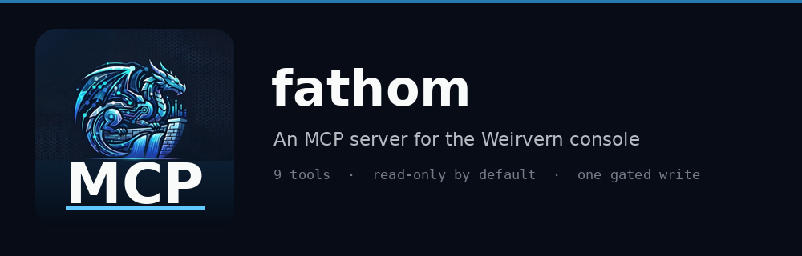

<div align="center">



</div>

# fathom

An [MCP](https://modelcontextprotocol.io) server that puts the Weirvern console in
front of a model as ten callable tools, so an investigation happens inside the
agent loop instead of in a terminal someone is copying output out of.

Ten tools. Nine read. One writes, and it files a proposal rather than a block.

Part of the [Weirvern](https://github.com/hodlhart/weirvern) project: the console,
the detectors and the sensor fleet live in that repository, and fathom is the
agent-facing read layer over its API. It needs a running console; it is not a
standalone passive sensor.

[](https://github.com/hodlhart/fathom/actions/workflows/tests.yml)
[](LICENSE)
[](requirements.txt)

## Why it exists

Weirvern collects flows, DNS, Zeek logs and detector decisions, and its console
already answers every question an analyst asks. What it could not do is answer
those questions to an agent, one after another, while the agent follows a thread.

Fathom is that seam. Ask it what talked to what, which host is beaconing, what the
alerting decided, and it will go and read the console and come back with an
answer. The agent never sees the console's API; it sees tools with docstrings that
describe what the answer will be.

## The tools

| Tool | What it answers |
|---|---|
| `list_ripples` | What grouped into one incident, its severity, and the evidence under it |
| `list_anomalies` | What did the detectors flag recently, highest score first |
| `hunt_flows` | Flows for one host, one port or one protocol |
| `get_host` | What is known about a host: volume, peers, ports, services |
| `get_finding_evidence` | The evidence behind one finding, as the console argues it |
| `query_zeek` | One Zeek log (dns, ssl, http, conn) |
| `top_talkers` | The shape of the traffic: loudest talkers, protocol mix, busiest ports |
| `dns_names` | Names hosts resolved recently, for command and control triage |
| `alert_audit` | The pipeline's self-audit: silent sensors, expired rules, unreadable checks |
| `propose_block` | **Propose** blocking a host. See the boundary below |

**`list_ripples` says which kind of empty it is.** An empty ripple list has several different
meanings and the payload carries the counts that tell them apart: nothing was measured, nothing
measured was inside a monitored network, the rows were too few to decide, the baselines were too
short to judge, or it was measured and nothing grouped. Each gets its own sentence, because "no
ripple" on its own has been read as a quiet network when it meant a broken read. The empty answer
also names the scales the deployment could measure and the retention they came from, since a short
retention quietly removes scales rather than reporting that it did.

**One family is not corroboration.** A ripple can form on a single family when that family clears
the extreme bar, and the tool says so on its own line instead of listing it beside the corroborated
ones as if they were the same claim. `severity` is the engine's own band, not a judgement fathom
makes, and `score` is the joint surprise used to rank, not a probability.

If the payload loses a field the tool needs, it says the shape is not understood rather than
rendering blanks, since a renamed key would otherwise look like a ripple with nothing in it. The
route has moved twice already, so that guard stays. Treat it as no answer, not an empty one.

## The write boundary

`propose_block` is the only tool that changes anything, and it does not block.

It records a proposal: host, reason, evidence, and how long a block should last.
A person then decides in the console. Nothing is blocked until someone clicks, and
the proposal carries who asked (`agent:fathom`) so the decision has a source.

That split is the reason an agent is allowed to call it at all. A detector that can
block directly can take a network away on a bad day, and a model that can block
directly can do it for a reason that reads convincing and is wrong. Filing a
proposal costs an operator three seconds and preserves the one check that is hard
to automate: a human reading the reasoning.

It needs an **admin** credential. A viewer token reads everything and gets a 403
here, which is the design working rather than a fault.

## Install

Python 3.10 or newer at the language level. The pinned `requirements.txt` needs
3.11: several current transitive packages have dropped 3.10. On 3.10, install
`mcp==1.30.0` and let the resolver choose compatible versions, which is what CI's
3.10 job does.

```bash
git clone https://github.com/hodlhart/fathom.git
cd fathom
python -m venv .venv
.venv/bin/pip install -r requirements.txt
```

On Windows the interpreter is `.venv\Scripts\python.exe`; everything else below is
the same. To run the test suite as well, install the development pins:

```bash
.venv/bin/pip install -r requirements-dev.txt
```

## Configuration

There is no default address on purpose: a deployment's address is environment
specific and does not belong in a repository. Fathom reads its configuration from
the environment of the process the MCP client spawns.

| Variable | Meaning |
|---|---|
| `WEIRVERN_API_URL` | **Required.** The console base URL, for example `https://console.example.com`, with no `/api` suffix |
| `WEIRVERN_TOKEN_FILE` | A file holding a token minted in the console. Preferred. |
| `WEIRVERN_TOKEN` | The token itself, for a throwaway run. Avoid: shell history and `/proc` |
| `WEIRVERN_SESSION_FILE` | A file holding a session from `/api/login` |
| `WEIRVERN_SESSION` | The session value itself |
| `WEIRVERN_USERNAME` + `WEIRVERN_PASSWORD` | Sign in at `/api/login` when no token or session is set |
| `WEIRVERN_CA_BUNDLE` | Optional. The console's CA certificate, if it does not use a public one |

The order is token, then session, then username/password. The first one set wins.

**A token and a session travel in different headers**, and the distinction is not
cosmetic. A minted token goes in `X-Weirvern-Token`; a session from `/api/login`
goes in `X-Weirvern-Session`. Sending a token as a session authenticates nothing
and the console answers a plain 401 that names neither. That is why the variable
names matter: `WEIRVERN_TOKEN_FILE` for a token, `WEIRVERN_SESSION` for a session.

### Generate a token in Weirvern

The console can mint a scoped credential, and that is the right thing to give an
agent: it carries a role, it is revocable on its own, and it is attributable in the
audit log. The path below is the one in the console source
(`weirvern/admin/web/index.html`, card `st-tokens-card`; route
`POST /api/tokens/create` in `weirvern/admin/flask_app.py`).

1. **Sign in to the console as an admin.** Token management is account-only: a
   token cannot mint or revoke another token, because a credential that can do
   that can outlive its own revocation.
2. **Open Settings** in the console navigation (the last group of tabs, beside
   Logs).
3. **Find the API tokens card.**
4. **Create the token.** Type a name in the field whose placeholder is
   *"what is it for"*, choose the role, then click **Create token**:
   - **viewer** — read-only. This is the role for the nine read tools. (The
     console calls it `viewer`; there is no separate "readonly" role name.)
   - **admin** — only if `propose_block` must be able to file a proposal. A
     viewer token gets 403 on that one tool.
5. **Copy the value at creation time.** It appears in the field labelled *"the new
   token; copy it now"* and is never shown again: the store keeps a display prefix
   and a SHA-256 digest, so a lost token is revoked and replaced, not recovered.
6. **Store it outside the repository**, in a file only you can read. Paste at the
   prompt rather than putting the value on a command line, where it would land in
   shell history:

   ```bash
   umask 077 && cat > ~/.weirvern-agent-token
   # paste the token, press Enter, then Ctrl-D
   chmod 600 ~/.weirvern-agent-token
   ```

   Do not commit it, paste it into a README, an issue, or a chat message. If your
   client cannot pass a file path, the value can live in the server's `env` block
   instead, as `WEIRVERN_TOKEN` — that is the variable the client reads, and the
   one that travels in `X-Weirvern-Token`. Do not put a minted token in
   `WEIRVERN_SESSION`: that variable is for a login session and a different
   header. `.mcp.json` is gitignored here for exactly this reason; keep it at mode
   600 and never commit it.

**If "Create token" answers 502.** The card is present but the deployment cannot
mint: the console's GUI pod must run with `serviceAccountName: weirvern-operator`
and a mounted service-account token. Without it the route answers
`could not create the token: no ServiceAccount token at
/var/run/secrets/kubernetes.io/serviceaccount/token`. This was observed against a
running demo console on 2026-11-23. When that is the deployment you have, use a
signed-in session instead (`WEIRVERN_SESSION` / `WEIRVERN_SESSION_FILE`, or
`WEIRVERN_USERNAME` + `WEIRVERN_PASSWORD` and let fathom sign in), or ask the
operator to fix the service account. A session reads the same nine tools; it
belongs to a person rather than to the automation, so it is revoked by signing out.

**Verify the credential before wiring the agent:**

```bash
WEIRVERN_API_URL=https://console.example.com \
WEIRVERN_TOKEN_FILE=$HOME/.weirvern-agent-token \
.venv/bin/python scripts/live_check.py
```

`live_check.py` calls `propose_block` first, because it is the only call that
proves the admin role arrived. It then reads the rest. A failure is diagnosed in
one line:

- **401** — the credential is wrong, expired, or sent in the wrong header. A token
  in `WEIRVERN_SESSION` is the common version of the last one.
- **403** — the credential is valid but the role is too low. On `propose_block`
  alone that means a viewer token; on every read it means the account cannot read
  the console at all.
- **a certificate error** — point `WEIRVERN_CA_BUNDLE` at the console's CA.
- **"Could not reach Weirvern"** — `WEIRVERN_API_URL` is wrong or the console is
  down.

## Wire it into an MCP client

A commit-ready example lives at [`.mcp.json.example`](.mcp.json.example). Copy it to
`.mcp.json` and put in absolute paths, because the client spawns the interpreter
directly:

```json
{
  "mcpServers": {
    "fathom": {
      "command": "/absolute/path/to/fathom/.venv/bin/python",
      "args": ["/absolute/path/to/fathom/server.py"],
      "env": {
        "WEIRVERN_API_URL": "https://console.example.com",
        "WEIRVERN_TOKEN_FILE": "/absolute/path/to/agent-token",
        "WEIRVERN_CA_BUNDLE": "/absolute/path/to/ca-bundle.pem"
      }
    }
  }
}
```

`WEIRVERN_CA_BUNDLE` is optional; delete that line when the console uses a
publicly trusted certificate. For Claude Desktop and other clients, and for
installing the `threat-hunt` skill, see [docs/SETUP.md](docs/SETUP.md).

Then, once:

```bash
claude mcp list     # fathom should appear; a project-scoped server needs one approval
claude              # then: "hunt for beaconing in the last 24 hours"
```

Fathom is a **stdio** server: the client spawns it per session and kills it at the
end. There is no port and no address. Anything printed to stdout corrupts the
protocol, which is why diagnostics go to stderr.

## Usage

Ask questions, not commands. The tools describe themselves well enough that the
model picks the right one:

- "Anything correlated in the last 24 hours? Start from the ripples."
- "192.0.2.10 looked odd yesterday. Who did it talk to, and what names did it resolve?"
- "Show me the evidence behind that finding, not just the score."
- "Is the deployment healthy? Any sensor silent or rule expired?"
- "Propose a block for that host for an hour, with the evidence attached."

A full worked investigation, with every call and answer, is in
[docs/transcript.md](docs/transcript.md).

## Failure modes and limitations

| Symptom | What it means | What to do |
|---|---|---|
| `WEIRVERN_API_URL is not set` | The client did not pass the environment | Put it in the server's `env` block |
| `Weirvern refused the credential (401)` | Wrong or expired credential, or a token sent as a session | Check the value and the header; mint a new token if needed |
| `(403)` on every read | The credential cannot read the console | Use a viewer or admin token for this deployment |
| `(403)` only on `propose_block` | Valid viewer token | Mint an admin token, or do not propose |
| `No such Weirvern resource (404)` | The route is not served at that address | `WEIRVERN_API_URL` must be the console root, not a path or a proxy prefix |
| `certificate is not trusted` | The console's CA is not in the system store | Set `WEIRVERN_CA_BUNDLE` |
| `Could not load the CA bundle` | `WEIRVERN_CA_BUNDLE` points at nothing | Fix the path, or unset it |
| `Could not reach Weirvern` | Wrong address, console down, or a timeout | Check the console; every request is bounded at 25 seconds |
| `returned something that is not JSON` | A proxy or login page answered instead of the API | Check the address and whether a reverse proxy rewrote it |
| `shape fathom does not understand` | The ripple route changed a field the tool needs | Treat it as no answer; re-check the route's shape |

Limits worth knowing before trusting an answer:

- **Nine reads, one proposal.** No tool blocks, dismisses, acknowledges or changes
  a detector. A proposal enforces nothing until an operator applies it.
- **No pagination.** Reads return a bounded page (`limit`, default 10 to 25) and the
  text says when rows were cut. It is not a data export; use the console's own
  exports for that.
- **Text, not JSON.** Columns are truncated to keep the model's context small.
  Long evidence lives in the console; audit findings carry a `fix` that names the
  view that owns them.
- **One console per process.** Configuration is read from the environment, so a
  session is bound to one deployment.
- **The ripple route is still moving.** Its fields have changed twice; the guard
  reports a rename as a contract change rather than printing blanks.
- **`alert_audit` is the pipeline auditing itself**, not a log of alert decisions.
  It answers "are the sensors and rules healthy", not "what happened after this
  alert".
- **No live console in the tests.** The suite proves the client, the tools and the
  stdio path against a stub whose payloads were transcribed from a running console;
  only `scripts/live_check.py` proves a particular deployment accepts you.

## Verifying it

```bash
.venv/bin/python -m pytest -q              # the full suite, no console needed
.venv/bin/python scripts/check_tools.py    # is every defined tool registered?
.venv/bin/python scripts/smoke_tools.py    # does each tool work, against known shapes?
.venv/bin/python scripts/live_check.py     # does the real console accept us?
```

| Script | Question | Needs a console |
|---|---|---|
| `pytest` | The client, the schemas, every failure path, stdout purity, the stub path | no |
| `check_tools.py` | Every `@mcp.tool()` in `server.py` actually reaches the running server | no |
| `smoke_tools.py` | Each tool assembles a request and formats an answer | a stub, started for you |
| `live_check.py` | The real console accepts the credential and answers | yes, with a credential |

`check_tools.py` exists because a tool written below
`if __name__ == "__main__": mcp.run()` is dead code: `run()` blocks, the decorator
never executes, and the file looks correct while the server serves one tool fewer.
It parses the decorators out of the syntax tree and compares them with the registry
at the moment `run()` is called.

CI runs the same suite on Python 3.10 and 3.12, plus `compileall` and `ruff`
([workflow](.github/workflows/tests.yml)).

## The skills

`.claude/skills/threat-hunt/SKILL.md` encodes the investigation method: what to look
at first, what a beacon looks like next to a busy host, and when filing a proposal
is justified. It drives the tools above and gives an operator a repeatable method to follow.

fathom gives the agent hands; the skill gives it a method. Installation for Claude
Code and Claude Desktop is in [docs/SETUP.md](docs/SETUP.md#install-the-threat-hunt-skill).

## Layout

```
server.py                  the MCP server: ten tools, stderr logging only
client.py                  the console API client, one credential path
tests/                     pytest: client, schemas, failures, stdio, stub path
scripts/check_tools.py     registration guard, no dependencies
scripts/smoke_tools.py     every tool against a stub console
scripts/stub_console.py    the stub: console wire shapes, 404 for anything else
scripts/live_check.py      the real console, with the failure named
scripts/list_tools.py      what a client is actually served
scripts/transcript.py      regenerates docs/transcript.md against the stub
docs/SETUP.md              MCP client and skill installation
docs/transcript.md         a worked hunt, labelled STUB
requirements.txt           the server's runtime freeze
requirements-dev.txt       the pinned test and lint tools CI uses
ca-bundle.pem              OPTIONAL, gitignored: the console's CA, if it uses its own
.claude/skills/            the threat-hunt skill
.github/workflows/         tests on 3.10 and 3.12, compileall and ruff
```

`ca-bundle.pem` is not in the repository on purpose: it belongs to one deployment,
and trusting one deployment's CA everywhere is worse than setting the variable
where it applies.

## Requirements

Python 3.10 or newer at the language level; the pinned set needs 3.11.
`requirements.txt` is a real freeze of the server's dependencies, not the
development environment, and several of its transitive pins
(`pydantic-settings`, `starlette`, `sse-starlette`, `python-multipart`,
`rpds-py`, `pycparser`) now require 3.11. On a 3.10 interpreter, install
`mcp==1.30.0` and let the resolver pick compatible versions; CI does exactly that
in its 3.10 job, and runs the frozen set on 3.12.
`requirements-dev.txt` adds the pinned test and lint tools.

## Part of Weirvern

The [Weirvern](https://github.com/hodlhart/weirvern) repository holds the console,
the detection pipeline, the sensor fleet and the API this server reads. Fathom is
the MCP front door for that system: the Flask app, the detector pipeline and this
server sit on top of the Weirvern API.

## License

MIT. See [LICENSE](LICENSE).
